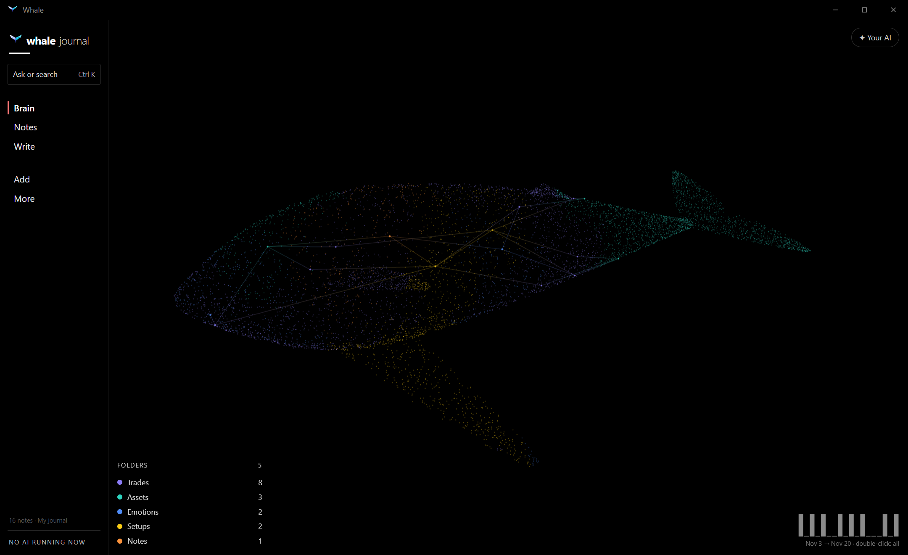
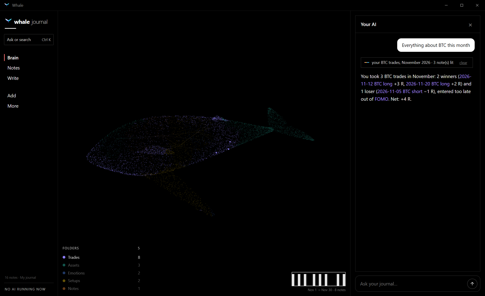
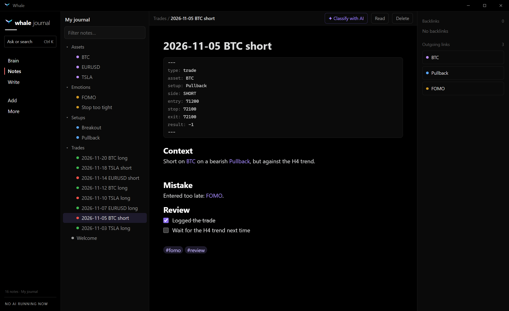
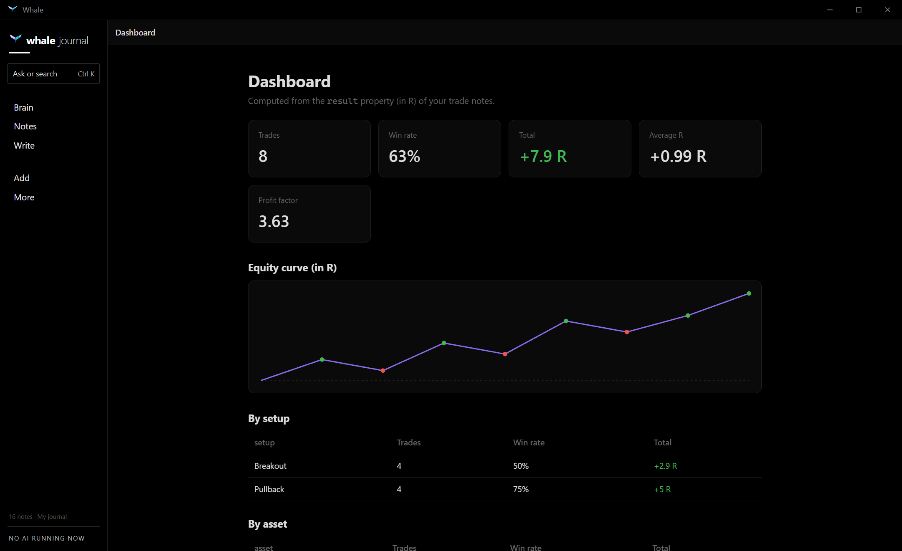
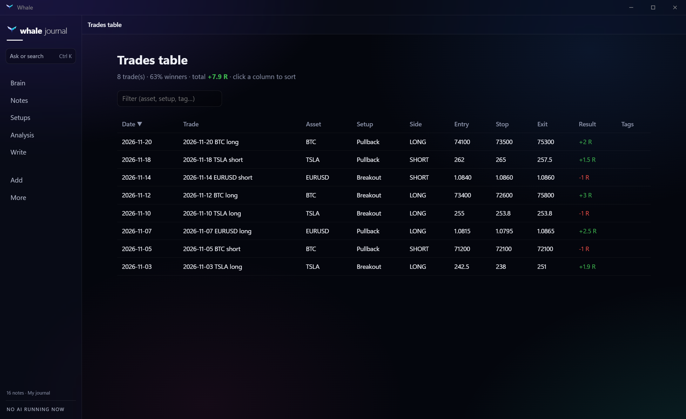
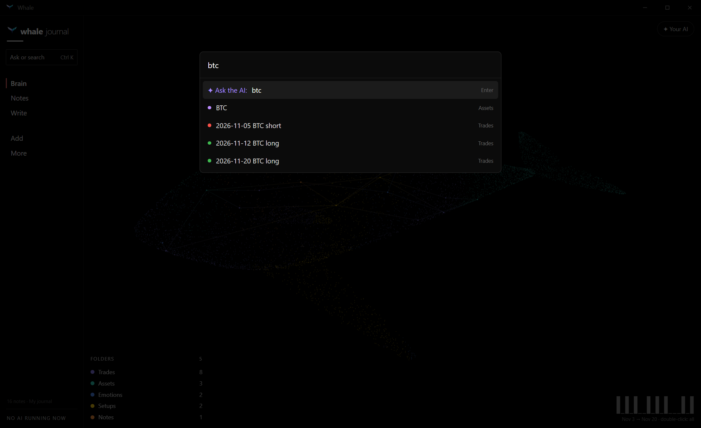

<p align="center">
  
</p>

<h1 align="center">Whale</h1>

<p align="center">
  <b>Your trading journal, as a second brain.</b><br>
  Local-first Markdown notes, a 3D whale-shaped brain, and an AI that answers from your own trades.
</p>

<p align="center">
  <a href="LICENSE"></a>
  
  
  
  
</p>

<p align="center">
  <a href="https://github.com/Kirby54/whale/releases/latest"><b>⬇ Download for Windows</b></a> ·
  <a href="#features">Features</a> ·
  <a href="#build-from-source">Build from source</a>
</p>

<p align="center">
  
</p>

---

## Why Whale

- 🗂️ **Your data stays with you.** Every note is a plain `.md` file in a folder on your computer. No account, no forced cloud, and any editor can open your notes.
- 📈 **Built for trading.** Trade properties (asset, setup, side, entry, stop, exit, result in R), dashboard, equity curve and broker trade import.
- 🧠 **A real second brain.** `[[Links]]`, backlinks, tags, your notes and your ChatGPT or Claude conversations in one place, and an AI that answers from all of it.

## Features

### 🐋 The brain, driven by your AI

Every note is a point in a 3D humpback whale, and every `[[link]]` is a thin thread. Notes are **placed by meaning**: notes about the same things (shared key words, links) sit next to each other, computed locally with no AI. Ask **Your AI** a question: it answers with your notes as sources **and lights up** the matching folder, period and notes in the brain. Hover the folder legend to highlight a folder, and drag the time histogram to focus on a period.

<p align="center"></p>

### ✍️ An Obsidian-style editor

Live preview built on CodeMirror 6: the Markdown syntax disappears outside the line you are typing on. Autocomplete for `[[links]]` and `#tags`, real checkboxes, chart screenshots pasted with <kbd>Ctrl</kbd>+<kbd>V</kbd>, backlinks and outgoing links on the side.

<p align="center"></p>

### 📊 Dashboard and trades table

Win rate, total and average R, profit factor, equity curve, and results by setup and by asset, all computed from your notes. The trades table is sortable and filterable.

<table>
  <tr>
    <td width="50%"></td>
    <td width="50%"></td>
  </tr>
</table>

### ⌨️ Ask or search, from anywhere

<kbd>Ctrl</kbd>+<kbd>K</kbd> finds any note, runs any action, or sends your question straight to the AI.

<p align="center"></p>

### And also

| | |
|---|---|
| **AI classification** | One click fills in a note's type, tags, date, summary and trade properties, and links it to your other notes. Works on a single note or the whole vault. |
| **Import** | Obsidian or Notion folders (Markdown), ChatGPT and Claude conversations (`conversations.json`), and broker trades as CSV (MT4/MT5, TradingView, Binance, IBKR…) with R computed for you. |
| **Timeline** | All your notes month by month, filterable by type. |
| **Native feel** | Black built-in title bar, 3 logos to choose from, and a ~8 MB app. |

## AI, your choice

| | Claude | Ollama |
|---|---|---|
| Where it runs | Anthropic API, with your own key | 100% on your computer |
| Cost | Pay-as-you-go, billed by Anthropic | Free |
| Default model | `claude-opus-5-5` | `llama3.1` (any Ollama model) |
| Your key | Stored in Windows Credential Manager, never in your notes | No key needed |

To answer, Whale sends the chosen provider your statistics and the notes relevant to the question. With Ollama, nothing leaves your machine. The AI answers in the language you ask in.

## Download

Get **`Whale_x.y.z_x64-setup.exe`** from the [latest release](https://github.com/Kirby54/whale/releases/latest) and run it. No admin rights needed; your notes go to `Documents\Whale` by default.

> Windows may show "Windows protected your PC" because the installer is not code-signed yet: click **More info → Run anyway**.

## Your notes are safe

- Every save is **atomic**: the note is written to a temporary file that then replaces it in one step, so a crash can never leave a half-written note.
- If you edit a note in another app while Whale is open, Whale **detects the conflict** and asks what to keep: your version, the other one, or both.
- If a save fails (locked file, full disk), Whale keeps your text and retries.

## Trade note format

```markdown
---
type: trade
date: 2026-11-03
asset: TSLA
setup: Breakout
side: LONG
entry: 242.5
stop: 238
exit: 251
result: 1.9
---
## Context
Clean break on [[TSLA]], [[Breakout]] setup.
```

`type` can be `trade`, `setup`, `asset`, `emotion`, `conversation` or `note`. `result` is in R (multiple of the risk).

## Shortcuts

| Shortcut | Action |
|---|---|
| <kbd>Ctrl</kbd>+<kbd>K</kbd> | Search a note or ask the AI |
| <kbd>Ctrl</kbd>+<kbd>N</kbd> | New trade |
| <kbd>Ctrl</kbd>+<kbd>E</kbd> | Switch between the editor and the reading view |
| <kbd>Ctrl</kbd>+<kbd>G</kbd> | Brain |
| <kbd>Ctrl</kbd>+<kbd>B</kbd> / <kbd>Ctrl</kbd>+<kbd>I</kbd> | Bold / italic |
| <kbd>Ctrl</kbd>+<kbd>L</kbd> | Checkbox |
| <kbd>Ctrl</kbd>+<kbd>F</kbd> | Find in the note |

## Build from source

Requirements: [Node.js](https://nodejs.org), [Rust](https://rustup.rs) and, on Windows, the Visual Studio C++ build tools.

```bash
git clone https://github.com/Kirby54/whale.git
cd whale
npm install
npm run dev      # run the app in development mode
npm run build    # build the Windows installer
npm test         # run the tests
```

## Code layout

| Folder | Contents |
|---|---|
| `src/` | The interface, no framework: `app.js` (core), `core.js` (pure, tested logic), `graph.js` (3D brain), `ai.js` and `aipanel.js` (AI), `import.js`, `views.js`, `ui.js` |
| `editor/` | Editor source (CodeMirror 6), bundled by esbuild into `src/vendor/editor.bundle.js` |
| `src-tauri/` | The Rust side: vault files, settings, import and AI calls |
| `tests/` | Logic tests (`npm test`); Rust tests with `cargo test` in `src-tauri/` |
| `assets/` | Logo options (the official icon is `a-ocean-gem`) and generated icons |
| `docs/screenshots/` | README screenshots, regenerated with `tools/screenshots.ps1` |
| `.github/workflows/release.yml` | Builds the installer and publishes a release when a `v*` tag is pushed |

Opening `src/index.html` in a browser also works: notes are then kept in the browser, which is handy for working on the interface.

## Roadmap

- [x] Windows installer in GitHub Releases
- [x] Safe writes and conflict detection when a note is edited elsewhere
- [x] Notes placed by meaning in the brain (local TF-IDF similarity + links)
- [ ] Optional AI embeddings for even better placement
- [ ] Editable properties form, code highlighting and tables in the editor
- [ ] macOS and Linux builds

## Contributing

Issues and pull requests are welcome. Run `npm test` before submitting a change.

## License

[MIT](LICENSE)

<sub>Screenshots use the example notes that ship with the app; the AI answer shown is an example.</sub>
